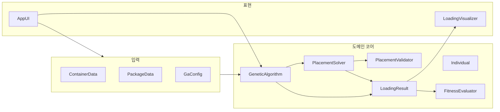

# 문서 메타 (ForAgents §5.4)

- 문서 종류: 작업 계획 (통합 로드맵)
- 저장 경로: `Info/plan/2026-10-27/160530_택배적재GA웹_plan.md`
- 최초 작성일(KST): 2026-10-27
- 지시자: 이종인
- 작업자: Composer
- 관련 기능 ID: 미정 (표 내 제안 ID 참고)
- 연관 계획:
  - [161500_1단계_데이터구조3D공간_plan.md](./161500_1단계_데이터구조3D공간_plan.md) — 현재 착수 범위(1단계) 상세
  - [161600_후속_미정사항_목록_plan.md](./161600_후속_미정사항_목록_plan.md) — §8 미정 항목(확정 없음)
- 이전 위치: `.cursor/plans/택배_적재_ga_웹_fbc14c77.plan.md` → 본 경로로 이동

---

---
name: 택배 적재 GA 웹
overview: 빈 워크스페이스에 Vite+TypeScript+Three.js로 도메인(배치·GA)과 3D 시각화를 분리 구현하고, 초안의 5단계 개발 순서에 맞춰 Extreme Point 기반 배치와 순열+방향 염색체 GA를 MVP로 완성합니다.
todos:
  - id: scaffold-vite
    content: Vite+TS+Three.js+Vitest 프로젝트 scaffold 및 Y-up 좌표 상수 정의
    status: pending
  - id: phase1-domain-viz
    content: ContainerData/PackageData/LoadingVisualizer + 입력 UI (1단계)
    status: pending
  - id: phase2-3-placement
    content: ExtremePoints, PlacementValidator, PlacementSolver + 단위 테스트 (2–3단계)
    status: pending
  - id: phase4-ga
    content: Individual, operators(OX), FitnessEvaluator, GeneticAlgorithm (4단계)
    status: pending
  - id: phase5-result-ui
    content: 최적 LoadingResult 3D 반영 및 적재/미적재 통계 (5단계)
    status: pending
  - id: info-docs
    content: Info/plan 복사, 기능_ID_목록 및 SW_Browser_* ID 문서 연결
    status: pending
isProject: false
---

# 유전 알고리즘 기반 택배 적재 — 웹 구현 계획

## 전제 및 선택 사항 (확정)

| 항목 | 결정 |
|---|---|
| 런타임 | 브라우저 |
| 언어·빌드 | TypeScript, [Vite](https://vitejs.dev/) |
| 3D | [Three.js](https://threejs.org/) (Y-up, 단위는 mm 또는 cm 중 하나로 코드 상수로 고정) |
| 회전 | **6방향** 축 정렬 (입력 `(w,d,h)`의 순열 6가지) |
| 워크스pace | [c:\Users\Slu93\Desktop\GeneticAlgorithm](c:\Users\Slu93\Desktop\GeneticAlgorithm) — 현재 **소스 없음**, greenfield |

초안 §8 중 MVP에서 **제안으로 고정**할 항목(구현 전 `Info` 개념 문서·개발자 확인 권장):

- **좌표계**: 적재함 한쪽 모서리를 원점 `(0,0,0)`, `+X` 가로, `+Y` 높이, `+Z` 세로(깊이). Three.js와 동일 축.
- **후보 위치**: **Extreme Point(EP)** — 이미 놓인 박스들의 `(maxX, y, z)`, `(x, maxY, z)`, `(x, y, maxZ)` 등 극점 + 바닥 `(0,0,0)` 및 인접 정렬점. 각 `(순서, 방향)`마다 EP를 **Y(높이) 오름차순 → Z → X**로 시도해 **첫 유효 위치**에 배치(결정적, GA 재현성 유리).
- **받침(MVP)**: 박스 **바닥면 전체**가 `y=0` 바닥이거나, 아래 박스들 **윗면(y = baseY)과 XY 투영 겹침**으로만 지지(겹침 면적 ≥ 바닥면적의 **100%**). 추후 §8 “받침 면적” 완화는 `PlacementValidator` 한곳에서 교체.
- **적합도**: `fitness = 1000 * loadedCount + volumeFillRatio * 100` (`volumeFillRatio = Σ(적재 부피) / 적재함 부피`). 동점 시 `loadedCount` 우선.
- **GA 기본값**: 개체 40, 세대 80, 토너먼트 k=3, **엘리트 2**, 교차 OX(순열), 돌연변이(순서 swap 0.08 / 방향 랜덤 0.08), 종료 = 세대 수 도달.
- **범위 밖(초안 유지)**: 무게, 파손, 배송 순서, 안정성(무게중심) — MVP 미포함.

---

## 아키텍처 (데이터 ↔ 배치 ↔ GA ↔ 3D)

초안 §5의 분리 원칙 유지: **Individual은 순서·방향·적합도만**, 좌표는 `PlacementSolver`가 매번 계산.



**의존 방향**: `viz` → `domain`/`placement`/`ga`만 참조. `placement`/`ga`는 Three.js 미참조.

---

## 저장소 구조 (제안)

```
GeneticAlgorithm/
  package.json
  index.html
  src/
    domain/
      ContainerData.ts
      PackageData.ts
      Individual.ts
      LoadingResult.ts
      GaConfig.ts
      types.ts          // Vec3, AABB, OrientationIndex
    placement/
      Orientation.ts    // 6 permutation
      PlacementValidator.ts
      PlacementSolver.ts
      ExtremePoints.ts
    ga/
      FitnessEvaluator.ts
      GeneticAlgorithm.ts
      operators.ts      // init, OX, mutate, tournament
    viz/
      LoadingVisualizer.ts
      sceneSetup.ts     // lights, OrbitControls, resize
    app/
      main.ts
      ui.ts             // 폼: 적재함·택배 목록·GA 설정·실행
  tests/
    placement/*.test.ts
    ga/*.test.ts
  Info/
    plan/2026-10-27/
    기능_ID_목록.md
```

테스트: **Vitest**로 `PlacementValidator`·고정 순서 배치·OX 무결성만 우선 (3D는 수동/스크린 확인).

---

## 기능 ID 및 문서 (ForAgents)

기존 ID 체계 없음 → 구현 **착수 시** [ForAgents v0.0.17](C:\Users\Slu93\Desktop\AiInfo\ForAgents\ForAgents_v0.0.17.md) §7에 따라 `Info/기능_ID_목록.md`에 등록. 실행환경 표기는 **`Browser`**(또는 개발자가 정한 Web 런타임명)로 목록에 명시.

| 제안 ID | 중분류(한글) | 책임 | 초안 단계 |
|---|---|---|---|
| `SW_Browser_LoadingScene_001` | 적재3D | 적재함·택배 메시, 카메라 | 1 |
| `SW_Browser_Placement_001` | 택배배치 | Solver, Validator, EP | 2–3 |
| `SW_Browser_GeneticAlgorithm_001` | 유전알고리즘 | GA, Fitness | 4 |
| `SW_Browser_LoadingVisualization_001` | 적재결과표시 | 결과 통계·미적재 ID·최종 배치 갱신 | 5 |

본 문서가 통합 계획의 저장본이다. 1단계 상세·§8 미정 목록은 상단 연관 계획 링크를 따른다.

---

## 단계별 구현 (초안 §7 대응)

### 1단계 — 데이터 구조 및 3D 공간

- `ContainerData` / `PackageData`: ID, `(width, height, depth)` — **동일 단위** float.
- `LoadingVisualizer`: 와이어프레임 적재함 + 택배 `BoxGeometry`/`MeshStandardMaterial`, `OrbitControls`.
- UI: 적재함 크기·택배 한 줄 추가(크기·수량) → 수량만큼 `pkg-{n}` ID 생성.
- **완료 기준**: 입력 크기로 적재함과 택배가 씬에 표시됨.

### 2단계 — 배치 기능 (순서 고정)

- `PlacementSolver.placeAll(container, packages, order, orientations)` → `LoadingResult` (`placed[]`, `unplacedIds[]`).
- 각 택배: 6방향 순회 × EP 후보 순회, validator 통과 시 배치.
- **완료 기준**: 고정 순서·방향 JSON/테스트 케이스로 `placed`/`unplaced` 목록이 결정적으로 나옴.

### 3단계 — 적재 조건 연결

- `PlacementValidator`: (1) AABB ⊆ container (2) 기존 placed와 AABB non-overlap (3) 받침 규칙(MVP 100%).
- 겹침/경계 실패 시 다음 후보; 전부 실패 시 미적재.
- **완료 기준**: 단위 테스트로 경계·겹침·공중 부유·바닥/적재 케이스 통과.

### 4단계 — 유전 알고리즘

- **염색체**: `order: string[]`(택배 ID 순열), `orientations: number[]`(0–5, order와 동일 길이).
- `GeneticAlgorithm.run(config, packages, container)` → 최적 `Individual` + `LoadingResult` 스냅샷.
- 세대 루프: evaluate → elitism → tournament → OX → mutate → repeat.
- **성능**: 세대당 `population × placeAll` — MVP 규모(택배 ≤ ~30, population 40)는 동기 실행; 필요 시 `setTimeout`/`requestIdleCallback`로 UI 프리즈 방지만 추가.
- **완료 기준**: 동일 seed(난수 시드 옵션)에서 세대 진행·최적 보관·종료 후 결과 반환.

### 5단계 — 결과 표시 연결

- GA 종료 후 `LoadingVisualizer.applyResult(LoadingResult)`: 적재 박스 위치/색, 미적재는 씬 밖 또는 목록만.
- 패널: 적재 수 / 미적재 수 / 미적재 ID 목록.
- **완료 기준**: 탐색 최종 결과가 3D와 통계에 일치.

---

## 실행 흐름 (초안 §6)

1. UI에서 적재함·택배·`GaConfig` 입력  
2. `GeneticAlgorithm` 초기 개체(랜덤 순열·방향)  
3. 개체마다 `PlacementSolver` → `FitnessEvaluator`  
4. 역대 최적 `LoadingResult` 보관  
5. 선택·OX·돌연변이 → 다음 세대  
6. 종료 후 `LoadingVisualizer` + 통계  

---

## 검증 방법

| 대상 | 방법 |
|---|---|
| Validator / Solver | Vitest 고정 시나리오 (소형 2~3 box, 알려진 최적 배치) |
| GA | 소규모 데이터에서 `loadedCount`가 랜덤 순서 대비 개선되는지 로그 |
| 3D | 수동: 겹침 없음, 바닥/받침 시각 확인 |
| 회귀 | `tests/` CI는 추후; 로컬 `npm test` |

---

## 리스크 및 완화

- **EP + first-fit**은 전역 최적 보장 없음 → GA 목적에 부합; 품질 이슈 시 후보 생성(BLF, 더 많은 코너)만 `ExtremePoints` 확장.
- **6방향 × 많은 EP** → 박스 수 50+ 시 느려질 수 있음 → population/세대 UI 상한 안내.
- **받침 100%**는 현실보다 엄격 → 미적재 많으면 §8에서 면적 비율 파라미터화.

---

## 구현 착수 시 첫 작업 순서

1. `npm create vite@latest` (vanilla-ts), `three`, `vitest` 설정  
2. `domain` + `viz` 스켈레ton (1단계)  
3. `placement` + 테스트 (2–3단계)  
4. `ga` + UI 실행 (4–5단계)  
5. `Info/기능_ID_목록.md`, 각 ID `Concept`/day·plan 링크 (ForAgents·ForAgentsConcept)
